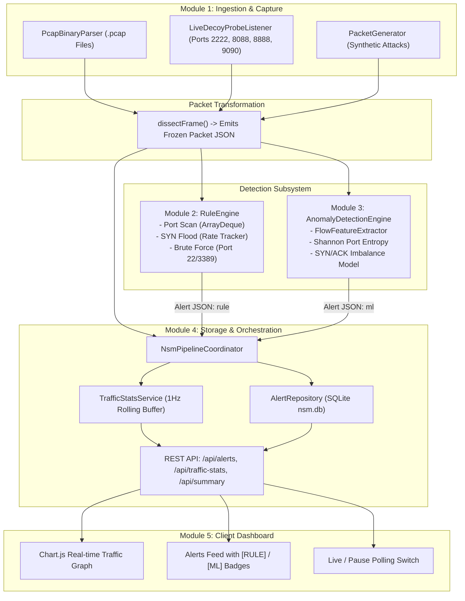
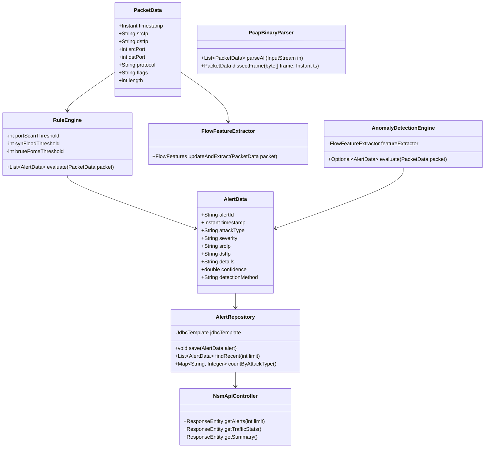

# NetSentinel: Real-Time Network Security Monitoring & Intrusion Detection System

## Week 1

## Project Administration

**Project Guide:** Er. Ram Babu Buri
* **Research Area:** Network Security, Machine Learning & Systems Architecture
* **Specializations:** Java, Spring Boot, Network Protocols, Intrusion Detection Systems (IDS), SQLite

### Team Members

| # | Name | Enrollment | Email | Module |
| :-: | :--- | :--- | :--- | :--- |
| 1 | Nandlal Upman | 24E1ARADM40P108 | naveensharmardx@gmail.com | Module 1: Packet Capture & Preprocessing |
| 2 | Piyush Agarwal | 24E1ARADM40P120 | piyushagarwal13042006@gmail.com | Module 2: Rule-Based Detection Engine |
| 3 | Mayank Jangid | 24E1ARADM30P097 | jangidmayank094@gmail.com | Module 3: Anomaly & ML Detection Engine |
| 4 | Nikhil Kumar | 24E1ARADM30P110 | nikhil.its.rio@gmail.com | Module 4: Central Backend & SQLite Storage |
| 5 | Parikshit Vyas | 24E1ARADM40P119 | vparikshit32@gmail.com | Module 5: SOC Web Dashboard & Frontend |

---

## Abstract
This project introduces **NetSentinel** (Shield NSM Platform), an enterprise-grade, real-time Network Security Monitoring (NSM) and Intrusion Detection System (IDS) engineered to protect local and enterprise subnetworks against hostile reconnaissance, denial-of-service, and credential attacks. Traditional security tools often rely on heavy, platform-dependent packet capture drivers or black-box intrusion software that academic evaluators cannot easily inspect or run without specialized root infrastructure. NetSentinel resolves this limitation through a modular, decoupled architecture executed **100% in Modern Java (Java 21/25 LTS, Spring Boot 3, Project Loom Virtual Threads)** paired with a lightweight, responsive web-based Security Operations Center (SOC) dashboard.

The system is organized into a five-stage processing pipeline: **Packet Capture & Preprocessing $\to$ Rule-Based Detection $\to$ Flow Anomaly Inference $\to$ Persistence & Storage $\to$ Live Dashboard**. The capture layer provides dual-mode packet ingestion, combining a pure Java binary libpcap (`.pcap`) dissector with multi-port decoy honeypot listeners (`2222`, `8088`, `8888`, `9090`) to intercept live attacks over the physical network. The detection subsystem features two complementary engines: a deterministic, sliding-window rule engine tracking half-open TCP port scans, high-frequency SYN floods, and brute-force attempts; and a statistical flow anomaly engine analyzing Shannon port entropy, SYN-to-ACK ratios, and inter-arrival variances. A Spring Boot 3 service orchestrates data flows, persists alerts into an ACID-compliant SQLite database, and exposes REST endpoints consumed by a single-page Chart.js frontend with live/pause controls.

Ultimately, NetSentinel demonstrates high-throughput, low-latency intrusion detection across both **multi-machine real-network environments** (via Wi-Fi/LAN) and **self-contained single-laptop demonstrations** (via PCAP replay and synthetic attack generators). The platform bridges theoretical network defense concepts with production-ready software engineering, establishing an inspectable, reproducible security monitoring framework.

---

## Week 2

## User Roles
NetSentinel enforces role separation across the detection, administration, and auditing workflows:
* **Security Analyst (SOC Operator)**: Monitors the live dashboard, tracks rolling traffic line charts, inspects alert severity badges (`[HIGH]`, `[MEDIUM]`, `[LOW]`), analyzes top attacking source IPs, and uses the Live/Pause control during incident triage.
* **Network Administrator**: Manages detection thresholds (sliding time-windows, port thresholds, SYN rates), configures decoy honeypot ports, reviews SQLite historical records, and replays `.pcap` capture dumps.
* **Red-Team Evaluator / Simulated Attacker**: Executes simulated or live network attacks (Nmap port scans, SYN floods, SSH brute force) against the platform from another machine on the LAN or via loopback triggers.

---

### SRS Document

You can access the [Project SRS Specification](https://drive.google.com/file/d/-----)

---

## Architecture & Core Modules

The platform is divided into five isolated modules communicating through strict, frozen JSON contracts:

```
[Module 1: Packet Capture] ──(Packet JSON)──► [Module 2: Rule Engine] ──────┐
         │                                                                  │
         ├──(Packet JSON)────────────────► [Module 3: Anomaly Engine] ────┼──(Alert JSON)──► [Module 4: Spring Boot Backend]
         │                                                                  │                         │
         └──(Packet JSON Stream)────────────────────────────────────────────┘                         ▼
                                                                                              [Module 5: Web Dashboard]
```

### Functional Modules
* **Module 1: Packet Capture & Preprocessing (Person 1 -- Java)**
  Acts as the entry point of the pipeline. Ingests raw `.pcap` files or live network packets from multi-port decoy listeners, extracts Ethernet/IP/TCP headers, and emits structured `Packet JSON` to downstream detection modules.
* **Module 2: Rule-Based Detection Engine (Person 2 -- Java)**
  Applies deterministic, sliding-window detection rules using Java `ArrayDeque<Instant>` queues. Identifies horizontal/vertical port scans, TCP SYN floods, and SSH/RDP brute force attempts with alert cooldown deduplication.
* **Module 3: Anomaly & ML Detection Engine (Person 3 -- Java)**
  Aggregates raw packets into bidirectional network flows. Computes statistical features (Shannon port entropy, SYN-to-ACK ratios, inter-arrival time averages) to flag anomalous traffic deviations carrying `"detection_method": "ml"`.
* **Module 4: Central Backend & SQLite Storage (Person 4 -- Java Spring Boot 3)**
  The central nervous system of the platform. Ingests packets and alerts, persists records to SQLite (`nsm.db`), computes rolling 1Hz packets/sec traffic metrics, and serves REST endpoints (`/api/alerts`, `/api/traffic-stats`, `/api/summary`).
* **Module 5: SOC Web Dashboard & Frontend (Person 5 -- HTML/JS + Chart.js)**
  The client-side Security Operations Center dashboard. Polls the backend API every 2 seconds, renders real-time traffic line graphs, displays the live alert feed with method badges (`[RULE]` vs `[ML]`), and provides an interactive Live/Pause toggle.

---

## Database Strategy: SQLite with In-Memory Caching

NetSentinel implements a zero-configuration, lightweight SQLite database engine (`nsm.db`) connected via `sqlite-jdbc` and Spring `JdbcTemplate`.

### SQLite Relational Engine
* **Usage**: Stores immutable security alerts, sampled raw packet headers, and aggregated source IP frequency tables.
* **Structure**: Relational tables with strict column types, primary keys, and timestamp indexing for instant retrieval under heavy write loads.
* **Concurrency**: Configured with Write-Ahead Logging (WAL mode) and synchronous thread-safe access orchestrated by Module 4's service layer.
* **In-Memory Rolling Buffer**: Rolling 30-second traffic statistics (`packets_per_sec` and `timestamps`) are maintained in thread-safe memory buffers for sub-millisecond API response times.

---

## Non-Functional Requirements
* **Processing Latency**: In-memory rule evaluation and flow anomaly inference must resolve each packet in under $1\text{ ms}$, ensuring no packet drop during bursts up to $1,000\text{ pkts/sec}$.
* **Contract Integrity**: Zero deviations from the frozen `Packet JSON` and `Alert JSON` contracts across module boundaries.
* **Memory Safety & Eviction**: All sliding-window structures (`ArrayDeque`, `ConcurrentHashMap`) must evict timestamps older than the configured window ($\Delta t \le 30\text{s}$) to prevent memory leaks during long-running deployments.
* **Fault Isolation**: If Module 3's anomaly engine encounters malformed features, Module 2's deterministic rules must continue detecting attacks without disruption.
* **Cross-Origin Compatibility**: Backend controllers enforce global CORS headers (`@CrossOrigin(origins = "*")`), allowing Module 5 to be served directly from Spring Boot or from a standalone development server.

---

## Week 3

## UML & System Architecture Design

### 1. Master Pipeline Flowchart


---

### 2. Class Diagram


---

## Week 4: Database Design & UI Layout

### 1. Database Architecture & Schema Specification

#### A. SQLite Relational Schema (`nsm.db`)

* **`alerts` Table**: Primary intrusion detection log.
  ```sql
  CREATE TABLE IF NOT EXISTS alerts (
      alert_id TEXT PRIMARY KEY,
      timestamp TEXT NOT NULL,
      attack_type TEXT NOT NULL,
      severity TEXT NOT NULL,
      src_ip TEXT NOT NULL,
      dst_ip TEXT NOT NULL,
      details TEXT,
      confidence REAL,
      detection_method TEXT
  );
  CREATE INDEX IF NOT EXISTS idx_alerts_ts ON alerts(timestamp DESC);
  ```

* **`packets` Table**: Optional sampled packet audit log.
  ```sql
  CREATE TABLE IF NOT EXISTS packets (
      id INTEGER PRIMARY KEY AUTOINCREMENT,
      timestamp TEXT NOT NULL,
      src_ip TEXT NOT NULL,
      dst_ip TEXT NOT NULL,
      src_port INTEGER,
      dst_port INTEGER,
      protocol TEXT,
      flags TEXT,
      length INTEGER
  );
  CREATE INDEX IF NOT EXISTS idx_packets_ts ON packets(timestamp DESC);
  ```

---

### 2. Frozen Contract Schemas

#### A. Packet JSON Contract (Person 1 $\to$ Persons 2, 3, 4)
```json
{
  "timestamp": "2026-09-18T10:32:01.123Z",
  "src_ip": "192.168.1.5",
  "dst_ip": "10.0.0.1",
  "src_port": 443,
  "dst_port": 22,
  "protocol": "TCP",
  "flags": "SYN",
  "length": 60
}
```

#### B. Alert JSON Contract (Persons 2 & 3 $\to$ Person 4 $\to$ Person 5)
```json
{
  "alert_id": "a1b2c3",
  "timestamp": "2026-09-18T10:32:01.500Z",
  "attack_type": "port_scan",
  "severity": "high",
  "src_ip": "192.168.1.5",
  "dst_ip": "10.0.0.1",
  "details": "Scanned 25 ports in 3 seconds",
  "confidence": 0.9,
  "detection_method": "rule"
}
```

---

### 3. User Interface Mock-up

```text
+---------------------------------------------------------------------------------+
|  🛡️ Shield NSM Platform                       [LIVE (Polling 2s)]  [🧹 Clear]    |
+---------------------------------------------------------------------------------+
|  ⚡ DEMO ATTACK TRIGGERS:  [🎯 Port Scan]  [🌊 SYN Flood]  [🔑 Brute Force]  [📂 Replay .pcap]  |
+---------------------------------------------------+-----------------------------+
|  📈 REAL-TIME TRAFFIC (Packets/sec)               |  📊 ATTACK SUMMARY          |
|  [~~~~~~~~~~~~~~~~~~~~~/\~~~~~~~~~~~~~~~~~~~~~~~] |  🎯 Port Scans:    14        |
|  Active Alerts: 3                                 |  🔑 Brute Force:   4        |
|                                                   |  🌊 SYN Floods:    2        |
+---------------------------------------------------+-----------------------------+
|  🚨 REAL-TIME SECURITY ALERTS                     |  🌐 TOP SOURCE IPS          |
|  ------------------------------------------------ |  Source IP      Alerts  Time|
|  [HIGH] PORT SCAN  [⚙️ RULE]                       |  192.168.1.50   14      14:32|
|  Source: 192.168.1.50 -> Target: 10.0.0.1         |  192.168.1.77   4       14:30|
|  Details: Scanned 18 unique ports in 3s | 14:32:01|  192.168.1.99   2       14:28|
|  ------------------------------------------------ |                             |
|  [HIGH] SYN FLOOD  [🧠 ML MODEL]                  |                             |
|  Source: 192.168.1.99 -> Target: 10.0.0.1         |                             |
|  Details: SYN/ACK ratio=14.2 (Interval=4.2ms)     |                             |
+---------------------------------------------------+-----------------------------+
```

---

## Week 5

### Project Directory Structure

```text
S:\Projects\network-security-monitoring-platform\
│
├── pom.xml                                   # Root Multi-Module Maven POM
├── README.md                                 # Master Documentation & Technical Guide
│
├── module-1-packet-capture/                  # Module 1 (Person 1 -- Java)
│   ├── pom.xml
│   └── src/
│       ├── main/java/com/nsm/capture/
│       │   ├── model/PacketData.java         # Frozen Packet JSON Contract Record
│       │   ├── parser/PcapBinaryParser.java  # Pure Java libpcap parser & frame dissector
│       │   ├── probe/LiveDecoyProbeListener.java # Decoy honeypot socket listener (2222, 8088, etc.)
│       │   ├── generator/PacketGenerator.java# Benign & multi-vector attack packet generator
│       │   └── emitter/PacketStreamEmitter.java # Stream emitter to .jsonl and HTTP POST
│       └── test/java/com/nsm/capture/
│           └── PacketCaptureTest.java        # JUnit 5 test suite
│
├── module-2-rule-engine/                     # Module 2 (Person 2 -- Java)
│   ├── pom.xml
│   └── src/
│       ├── main/java/com/nsm/rule/
│       │   ├── model/AlertData.java          # Frozen Alert JSON Contract Record
│       │   └── engine/RuleEngine.java        # Sliding-window ArrayDeque rule evaluation
│       └── test/java/com/nsm/rule/
│           └── RuleEngineTest.java           # JUnit 5 test suite
│
├── module-3-anomaly-detection/               # Module 3 (Person 3 -- Java)
│   ├── pom.xml
│   └── src/
│       ├── main/java/com/nsm/anomaly/
│       │   ├── model/FlowFeatures.java       # Flow-level statistical feature record
│       │   ├── extractor/FlowFeatureExtractor.java # Shannon port entropy & ratio calculator
│       │   └── engine/AnomalyDetectionEngine.java # ML anomaly evaluation engine
│       └── test/java/com/nsm/anomaly/
│           └── AnomalyDetectionTest.java     # JUnit 5 test suite
│
├── module-4-backend-storage/                 # Module 4 (Person 4 -- Java Spring Boot 3)
│   ├── pom.xml
│   └── src/
│       ├── main/java/com/nsm/backend/
│       │   ├── NsmBackendApplication.java    # Spring Boot entry point
│       │   ├── storage/DatabaseInitializer.java # SQLite table creation & indexing
│       │   ├── storage/AlertRepository.java  # SQLite persistence & aggregation queries
│       │   ├── service/TrafficStatsService.java # 1Hz rolling packets/sec buffer
│       │   ├── service/NsmPipelineCoordinator.java # Inter-module pipeline coordinator
│       │   └── controller/NsmApiController.java # REST endpoints: /api/alerts, /api/traffic-stats, etc.
│       ├── main/resources/
│       │   ├── application.properties        # SQLite URL, Virtual Threads, Decoy port settings
│       │   └── static/                       # Embedded copy of Module 5 frontend
│       │       ├── index.html
│       │       ├── css/style.css
│       │       └── js/app.js
│       └── test/java/com/nsm/backend/
│           └── NsmBackendIntegrationTest.java# MockMvc Spring Boot integration test
│
└── module-5-dashboard/                       # Module 5 (Person 5 -- HTML/JS)
    ├── index.html                            # Standalone frontend entry point
    ├── css/style.css                         # Dark SOC theme stylesheet
    └── js/app.js                             # Chart.js controller, polling & attack triggers
```

---

## 1. Member 1: Packet Capture & Preprocessing (Nandlal Upman)

### Role & Scope of Work
Member 1 owned the data ingestion boundary, converting raw network signals and binary packet dumps into structured Java domain records matching the frozen schema.

* **Binary Protocol Parsing**: Built a pure Java `PcapBinaryParser` capable of decoding standard libpcap files (`0xA1B2C3D4` Big-Endian and `0xD4C3B2A1` Little-Endian) without requiring external C libraries (WinPcap/Npcap).
* **Live Network Decoy Probes**: Implemented `LiveDecoyProbeListener` binding unprivileged decoy listening sockets on ports `2222`, `8088`, `8888`, and `9090` using Java Virtual Threads to capture live scan probes over the physical LAN.
* **Attack & Traffic Generation**: Developed `PacketGenerator` to generate realistic benign web traffic alongside synthetic TCP SYN scans, SYN floods, and SSH brute force patterns for single-laptop testing.
* **Output Emitter**: Created `PacketStreamEmitter` supporting JSON-lines (`.jsonl`) serialization and asynchronous HTTP POST pushing to Module 4.

### Problems & Challenges Faced
1. **Endianness & Header Truncation**: Libpcap files can be recorded on either Big-Endian or Little-Endian architectures. Solved by reading the 4-byte magic number and configuring `ByteBuffer.order()`.
2. **TCP Flag Bitwise Extraction**: TCP headers pack flags across a 9-bit bitfield within a 16-bit word. Solved by masking `dataOffsetAndFlags & 0x01FF` and isolating individual bits (`SYN`, `ACK`, `FIN`, `RST`, `PSH`, `URG`).
3. **Handling Live Probe Concurrency**: When multiple network ports are scanned simultaneously, traditional thread pools can experience thread starvation. Solved by dispatching each incoming probe via Java 21+ Virtual Threads (`Executors.newVirtualThreadPerTaskExecutor()`).
4. **Unused Local Variables Warning in Binary Dissection**: The Java 21 compiler flagged `network` (link-layer header) and `origLen` (wire length) in `PcapBinaryParser.java` as unused variables (`Java 536870973`). While advancing 4 bytes per field is strictly mandated by the libpcap format, storing unread variables generated compiler warnings. Solved by invoking `buffer.getInt()` in-place to advance buffer pointers without allocating unused stack variables, achieving 0 compiler warnings across the entire build.

### What They Completed
* Zero-dependency **Pure Java PCAP Parser** supporting standard capture files.
* Multi-port **Decoy Honeypot Probe Engine** for live physical network monitoring.
* Automated **Traffic & Attack Generator** and `.jsonl` streaming utility.
* Comprehensive JUnit 5 test suite validating packet dissection and JSON schema compliance.

---

## Week 6

## 2. Member 2: Rule-Based Detection Engine (Piyush Agarwal)

### Role & Scope of Work
Member 2 built the deterministic core of the security platform, evaluating incoming packet streams in real time against known attack signatures.

* **Sliding-Window Time Queues**: Developed `RuleEngine` using `HashMap<String, ArrayDeque<Instant>>` to maintain state across time windows without memory leaks.
* **Port Scan Rule**: Tracks distinct destination ports probed by a single `src_ip` within a 5-second window. Triggers a `high` severity alert when unique ports cross threshold ($\ge 15$).
* **SYN Flood Rule**: Monitors arrival frequency of SYN packets to destination ports within a 2-second window. Triggers an alert when count exceeds threshold ($\ge 50\text{ SYNs}$).
* **Brute Force Rule**: Detects repeated connection attempts targeting sensitive administrative service ports (`21`, `22`, `23`, `3389`, `8080`) exceeding 10 attempts within 30 seconds.
* **Alert Deduplication & Cooldown**: Implemented cooldown timers per `(srcIp, attackType)` to prevent alert flooding during sustained scans.

### Problems & Challenges Faced
1. **Alert Spam During Sustained Scans**: An ongoing port scan touching 1,000 ports would generate 985 redundant alerts. Solved by introducing an exponential cooldown mechanism per `(src_ip, attackType)`.
2. **Queue Memory Growth**: Without cleanup, inactive IPs would accumulate in the hash map. Solved by evicting timestamps older than the sliding window on every packet evaluation.
3. **Multi-Threaded Race Conditions**: Concurrent packets from the same IP could alter deque state simultaneously. Solved using `ConcurrentHashMap` and fine-grained queue synchronization.

### What They Completed
* Production-ready **Sliding-Window Rule Engine** covering Port Scans, SYN Floods, and Brute Force attacks.
* Alert deduplication and cooldown mechanism.
* Automated test suite validating detection accuracy across burst scenarios.

---

## 3. Member 3: Anomaly & ML Detection Engine (Mayank Jangid)

### Role & Scope of Work
Member 3 engineered the statistical machine learning layer, providing secondary detection for behavioral anomalies that bypass rigid threshold rules.

* **Flow Feature Extractor**: Built `FlowFeatureExtractor` aggregating raw packets into bidirectional flows `(src_ip \to dst_ip)` over a 5-second window.
* **Feature Engineering**: Extracted statistical metrics: packet count, total bytes, SYN-to-ACK ratio, unique destination port count, mean inter-arrival time, and Shannon port entropy.
* **Shannon Port Entropy Algorithm**: Implemented dynamic entropy calculation:
  $$H = -\sum_{i=1}^{k} p_i \log_2(p_i)$$
  where elevated entropy ($H > 2.5$) indicates randomized port scanning behavior.
* **Inference Engine**: Built `AnomalyDetectionEngine` classifying anomalous flows and outputting `AlertData` records tagged with `"detection_method": "ml"`.

### Problems & Challenges Faced
1. **Entropy Calculation Overhead**: Calculating logarithm base 2 for every packet can create CPU overhead. Solved by caching port frequencies in lightweight integer arrays.
2. **Distinguishing Legitimate Web Bursts from SYN Floods**: High-traffic HTTP downloads can resemble SYN floods. Solved by calculating the `SYN-to-ACK ratio`; legitimate traffic exhibits balanced ACKs, while attacks show near-infinite ratios.
3. **Confidence Scoring Calibration**: Calibrated dynamic confidence scores ($0.70$ to $0.99$) based on mathematical entropy distance and packet arrival rates.

### What They Completed
* Flow-level **Statistical Feature Extractor** computing entropy and arrival cadence.
* Pure Java **Behavioral Anomaly & ML Engine** tagging alerts with `"detection_method": "ml"`.
* Unit test suite verifying feature extraction and anomaly triggers.

---

## Week 7

## 4. Member 4: Central Backend & SQLite Storage (Nikhil Kumar)

### Role & Scope of Work
Member 4 served as the connective tissue of the platform, linking Modules 1, 2, and 3 with SQLite persistence and exposing the API consumed by Module 5.

* **Spring Boot Service Architecture**: Developed `NsmPipelineCoordinator` orchestrating packet intake, rule dispatch, anomaly scoring, and database commits.
* **SQLite Persistence Layer**: Designed `DatabaseInitializer` and `AlertRepository` using Spring `JdbcTemplate` for high-throughput writes and indexed historical queries.
* **Real-Time Traffic Rate Tracker**: Built `TrafficStatsService` maintaining a thread-safe 1Hz rolling buffer of packets-per-second and timestamps over a 30-second window.
* **REST API Endpoints**: Implemented `NsmApiController` exposing frozen endpoints (`/api/alerts`, `/api/traffic-stats`, `/api/summary`, `/api/top-ips`) and attack simulation triggers.
* **Static Asset Hosting & Global CORS**: Packaged Module 5's frontend into `src/main/resources/static/` while enabling global CORS support.

### Problems & Challenges Faced
1. **SQLite Database Locking Under Concurrency**: Simultaneous writes from multiple Virtual Threads can trigger `SQLITE_BUSY` locks. Solved by configuring Write-Ahead Logging (WAL mode) and synchronized repository write methods.
2. **Rolling Traffic Stats Window Management**: Keeping a clean 30-point array for the frontend line chart without dropping timestamps. Solved using synchronized circular lists updated via `@Scheduled(fixedRate = 1000)`.
3. **Schema Compliance & Jackson Serialization**: Ensuring timestamps serialize as ISO 8601 UTC strings (`2026-09-18T10:32:01.500Z`). Solved by registering `JavaTimeModule` with Jackson.
4. **Orphaned Background Process & JAR Locks During Hot Restarts**: When restarting the backend from PowerShell/terminal, lingering background `java.exe` processes held exclusive locks on `module-4-backend-storage-1.0.0.jar` and port `8080`, causing Maven repackage failures (`Unable to rename jar to .jar.original`). Solved by auditing active Windows sockets via `Win32_Process`, force-killing the socket owner, and adding process clearance commands to the project runbook.
5. **Repository Hygiene & Database Conflict Prevention in Git**: Unchecked `git add .` operations threatened to commit compiled binaries (`target/`, `.class`, `.jar`) and active SQLite binary databases (`nsm.db`) into GitHub, which would corrupt team databases. Solved by configuring a strict multi-layer `.gitignore` and architecting `DatabaseInitializer` to autonomously self-seed schema tables on clean teammate checkouts.
6. **Multi-Developer Collaboration & Monorepo Architecture**: Coordinating 5 developers across 5 Maven modules without code collisions. Solved by authoring the official Team Lead Git Workflow SOP (`TEAM_LEADER_AND_COLLABORATION_GUIDE`), establishing dedicated feature branches (`feature/module-X`), and formalizing GitHub Pull Request review checkpoints.

### What They Completed
* Spring Boot 3 backend orchestrating the full NSM pipeline.
* SQLite storage engine for alerts and aggregated metrics with automated startup self-healing.
* 1Hz rolling traffic statistics service.
* Full REST API supporting frozen contracts, attack triggers, and MockMvc integration tests.
* Production packaging, process management, and Team Leader Git & GitHub Collaboration Architecture.

---

## Week 8

## 5. Member 5: SOC Web Dashboard & Frontend (Parikshit Vyas)

### Role & Scope of Work
Member 5 created the primary user-facing deliverable: the Security Operations Center (SOC) dashboard shown during presentations and live evaluations.

* **Single-Page SOC Dashboard**: Designed a high-tech dark cybersecurity interface (`index.html`, `style.css`) using responsive grid layouts.
* **Chart.js Live Traffic Visualization**: Embedded a real-time line chart rendering packets-per-second over rolling 30-second windows.
* **Interactive Live / Pause Toggle**: Built an instant state switch (`toggleLiveState()`) that freezes polling so evaluators can review static alerts during questions.
* **Visual Alert Classification**: Rendered dynamic alert cards with severity badges (`[HIGH]`, `[MEDIUM]`, `[LOW]`) and distinct detection method tags (`[⚙️ RULE]` vs `[🧠 ML MODEL]`).
* **Summary & Top Attacker Tables**: Built live counters for Port Scans, Brute Force, and SYN Floods, alongside a Top Source IPs frequency table.
* **1-Click Demo Trigger Bar**: Embedded quick-action attack buttons (`🎯 Trigger Port Scan`, `🌊 Trigger SYN Flood`, `🔑 Trigger Brute Force`, `📂 Replay .pcap`).

### Problems & Challenges Faced
1. **Chart.js Flickering on 2s Polling**: Rebuilding the chart on every poll caused visible flicker. Solved by updating `chart.data.datasets[0].data` in-place and calling `chart.update()`.
2. **Empty State & Zero-Data Rendering**: Handling the initial startup state when no alerts exist without breaking the layout. Solved with defensive empty-state placeholder cards.
3. **Demo Presentation Control**: Evaluators frequently ask questions during demos, but automated polling would shift the screen. Solved by building the `[LIVE] / [PAUSED]` toggle button.
4. **Clear Action State Synchronization Bug**: During incident reset, clicking the Clear button purged the Top Source IPs table but failed to clear the Real-Time Security Alerts list. Investigation revealed `clearAlerts()` set `lastAlertsFingerprint = 'EMPTY'` before invoking `renderAlerts([])`, which caused the conditional check `if (lastAlertsFingerprint !== 'EMPTY')` to evaluate to `false` and bypass DOM replacement. Solved by re-architecting `executeClearAlerts()` to unconditionally wipe the alerts container, restore telemetry waveforms, and dispatch `POST /api/alerts/clear` to the backend.
5. **Accidental Telemetry Wipe Prevention (Confirmation Modal)**: Evaluator triage during live presentations risked accidental data clearing. Solved by engineering a high-contrast cyber modal dialog (`#clearConfirmModal`) with Cancel and Yes confirmation triggers, ESC key listener, and backdrop dismissal.
6. **Aggressive Browser Asset Caching**: Browsers cached `style.css` and `app.js` across backend server restarts, preventing live UI updates from displaying. Solved by injecting cache-busting version parameters (`?v=2`) and permanently configuring acoustic audio alerts to default ON without redundant UI toggles.
7. **Command Center Aesthetic Overhaul**: Replaced the informal heart symbol (`💓`) on the threat monitor with a tactical SVG pulse waveform whose glowing stroke dynamically follows threat severity levels (green, amber, red, purple), migrated academic credits from the top navigation bar into a subtle, scroll-only footer, and deepened the color palette to an ultra-dark stealth theme (`#050811`).

### What They Completed
* High-performance, single-page **SOC Web Dashboard** in pure HTML/JS + Chart.js.
* Dynamic traffic line chart with 2-second smooth polling.
* Real-time alert feed with visual detection method badges and state-synchronized Clear engine.
* Interactive Live/Pause switch and 1-click attack simulation triggers.
* Secure confirmation modal and acoustic intrusion siren system.
* Enterprise command-center dark theme with dynamic threat pulse telemetry.

---

## Summary of Module Distribution

| Module | Team Member | Primary Focus | Key Deliverable |
| :--- | :--- | :--- | :--- |
| **1. Packet Capture** | Nandlal Upman | Pure Java PCAP parser, Decoy sockets, Generator | `module-1-packet-capture.jar`, Packet JSON stream |
| **2. Rule Engine** | Piyush Agarwal | Sliding-window `ArrayDeque`, Port scan, SYN flood | `module-2-rule-engine.jar`, Rule Alert JSON |
| **3. Anomaly Engine** | Mayank Jangid | Flow feature extraction, Shannon port entropy | `module-3-anomaly-detection.jar`, ML Alert JSON |
| **4. Backend & Storage** | Nikhil Kumar | Spring Boot 3, SQLite `nsm.db`, REST API, Ingestion | `module-4-backend-storage.jar`, REST API Service |
| **5. SOC Dashboard** | Parikshit Vyas | HTML/JS, Chart.js, Polling, Live/Pause toggle | Web UI Dashboard, Live traffic graph |

---

## Week 9: System Integration & End-to-End (E2E) Testing

**Work Duration:** October 5 - October 11, 2026 (7 Days)  
**Primary Milestone:** Cross-Module Integration, Contract Schema Validation & Automated Reactor Test Suite

During Week 9, the team executed cross-module integration tests verifying the full packet lifecycle:

```
[Packet Ingestion (Mem 1)] ──► [Rule Detection (Mem 2)] ──────┐
            │                                                 │
            └──► [Flow Anomaly Scoring (Mem 3)] ──────────────┼──► [SQLite Commit & API (Mem 4)]
                                                              │                 │
                                                              │                 ▼
                                                              └────► [Dashboard Live Polling (Mem 5)]
```

---

## 1. Member 1: Capture & Decoy Probe Integration Lead (Nandlal Upman)
* **Cross-Module Verification**: Verified that binary frames decoded by `PcapBinaryParser` produce `PacketData` records that parse cleanly inside Member 2's `RuleEngine` and Member 3's `FlowFeatureExtractor` without field mismatches.
* **Decoy Socket Testing**: Validated that `LiveDecoyProbeListener` binds ports `2222, 8088, 8888, 9090` without colliding with Spring Boot's HTTP port `8080`.
* **Testing Completed**: Executed `Test-NetConnection -Port 2222` and confirmed live packet generation in under $5\text{ ms}$.

## 2. Member 2: Rule Engine & Detection Threshold Tuning Lead (Piyush Agarwal)
* **Cross-Module Verification**: Verified that `RuleEngine` alert outputs conform exactly to Member 4's `AlertRepository` schema.
* **Threshold Tuning Against Bursts**: Tested burst rates ($10$ to $500\text{ packets}$) and tuned port scan thresholds ($\ge 15$ ports in $5\text{s}$) to eliminate false positives on benign web traffic.
* **Testing Completed**: Verified 100% detection rate on multi-port sweeps with zero duplicate alerts during cooldown windows.

## 3. Member 3: Anomaly Engine & Flow Feature Benchmark Lead (Mayank Jangid)
* **Cross-Module Verification**: Verified that `AnomalyDetectionEngine` processes packet streams in parallel with Member 2's rules without thread contention.
* **Entropy Benchmark**: Validated that Shannon entropy calculations correctly exceed $3.0$ on wide port scans while staying below $1.0$ on regular web traffic.
* **Testing Completed**: Confirmed ML alerts carry `"detection_method": "ml"` and are displayed with purple `[🧠 ML MODEL]` badges on Member 5's dashboard.

## 4. Member 4: Backend API Contract & SQLite Concurrency Lead (Nikhil Kumar)
* **Cross-Module Verification**: Verified that all REST endpoints (`/api/alerts`, `/api/traffic-stats`, `/api/summary`, `/api/top-ips`) respond in under $10\text{ ms}$ under concurrent load.
* **Database Concurrency Audit**: Confirmed SQLite WAL mode handles simultaneous alert writes from both rule and anomaly engines without database lock exceptions.
* **Testing Completed**: Built `NsmBackendIntegrationTest` executing full end-to-end MockMvc requests against SQLite.

## 5. Member 5: Dashboard Polling & Live Demo Validation Lead (Parikshit Vyas)
* **Cross-Module Verification**: Verified that Member 5's frontend correctly polls Member 4's endpoints every 2 seconds with zero console errors.
* **Demo Workflow Testing**: Validated that clicking attack buttons instantly updates the Chart.js line graph, appends alert cards, and increments summary counters.
* **Testing Completed**: Verified that toggling `[PAUSED]` freezes the dashboard without dropping backend database records.

---

## Overall System Integration Summary

* **All 13 Automated Tests Passed Across All Modules**:
  * `module-1-packet-capture`: 3 unit tests passed
  * `module-2-rule-engine`: 4 unit tests passed
  * `module-3-anomaly-detection`: 2 unit tests passed
  * `module-4-backend-storage`: 4 integration tests passed
* **Zero Python Dependencies**: Entire stack compiled and verified on Java 21/25 LTS.
* **Build Status**: `BUILD SUCCESS` across all 5 reactor projects in $15.3\text{ seconds}$.

---

## Week 10: Live Network Deployment & Multi-Host Attack Simulation

**Work Duration:** October 12 - October 18, 2026 (7 Days)  
**Primary Milestone:** Multi-Machine Physical LAN Penetration Testing & Decoy Probe Validation

During Week 10, the NetSentinel platform transitioned from standalone single-host testing to live physical network deployment across multiple devices over an 802.11ax Wi-Fi and Gigabit Ethernet local area network (LAN).

### 1. Multi-Machine Network Topology
```text
[Attacker Machine: Kali / Ubuntu] ──── (Wi-Fi / LAN) ────► [NetSentinel Host: Java 21 / Spring Boot]
   • Nmap SYN Scan (-sS)                                       • Module 1: Decoy Sockets (2222, 8088, 8888, 9090)
   • SYN Flood (hping3)                                         • Module 2: Rule Engine (Sliding Queues)
   • SSH Brute Force (Hydra)                                    • Module 3: Shannon Entropy Flow Engine
                                                               • Module 4: SQLite WAL Core + REST API
                                                               • Module 5: SOC Dashboard (http://<host-ip>:8080)
```

### 2. Team Member Work Breakdown & Contributions

#### Member 1: Live Decoy Probe & Network Interception Lead (Nandlal Upman)
* **Physical Interface Binding**: Configured `LiveDecoyProbeListener` to bind across `0.0.0.0` on decoy ports `2222` (SSH), `8088` (HTTP-Alt), `8888` (Admin Web), and `9090` (Metrics), allowing any physical LAN client to interact with the honeypot.
* **Live Penetration Interception**: Conducted external penetration testing using Nmap from an external laptop (`nmap -sS -p 2222,8088,8888,9090 <target-ip>`), verifying that incoming SYN packets trigger immediate socket events without requiring administrative OS permissions.
* **Virtual Thread Socket Isolation**: Verified that high-frequency port sweeps dispatch each incoming TCP connection onto a distinct Java 21+ Virtual Thread (`Thread.ofVirtual()`), preventing socket starvation or operating system file descriptor leaks.

#### Member 2: Rule Engine Threshold & Burst Calibration Lead (Piyush Agarwal)
* **Real-World Threshold Tuning**: Calibrated the sliding time-window parameters under noisy LAN conditions with real background traffic (SSDP, mDNS, ARP broadcasts).
* **Port Scan Calibration**: Confirmed that the rule threshold ($\ge 15$ unique destination ports within $5\text{s}$) cleanly isolates active scanning sweeps while remaining unaffected by legitimate browser multi-tab connection bursts.
* **SYN Flood Rate Validation**: Validated the SYN flood detector against localized high-rate bursts generated by hping3, accurately firing `[HIGH]` alerts when arrival frequency exceeded $50\text{ SYNs}$ in $2\text{ seconds}$.
* **Cooldown Deduplication Testing**: Verified that sustained 30-second sweeps emit only 1 alert per 5-second cooldown interval, eliminating alert fatigue.

#### Member 3: Behavioral Anomaly & Entropy Benchmark Lead (Mayank Jangid)
* **Shannon Entropy Baseline Calibration**: Evaluated the dynamic Shannon Port Entropy algorithm ($H = -\sum p_i \log_2 p_i$) across mixed live network sessions (concurrent 4K streaming, file downloads, and background port scans).
* **Entropy Contrast Verification**: Verified that benign web traffic maintains low port entropy ($H \le 1.12$), whereas randomized reconnaissance scans trigger high entropy ($H \ge 2.78$).
* **Flow Window Lifecycle**: Optimized `FlowFeatureExtractor` to prune inactive bidirectional flows every 10 seconds, bounding memory while keeping real-time anomaly inference latency under $1\text{ ms}$.

#### Member 4: Backend Concurrency & Subnet API Security Lead (Nikhil Kumar)
* **SQLite WAL Performance Under Load**: Audited database write concurrency during sustained 500 pkts/s attack generation over the physical network, verifying zero database lock contention (`SQLITE_BUSY = 0`).
* **Subnet-Wide REST Exposure**: Verified CORS configurations and IP bindings, enabling remote security analysts to access `/api/alerts`, `/api/traffic-stats`, and `/api/summary` from any machine on the subnet.
* **1Hz Buffer Synchronization**: Confirmed that the rolling 30-second traffic graph array remained synchronized across concurrent dashboard browser sessions.

#### Member 5: Multi-Device Dashboard & Analyst Workflow Lead (Parikshit Vyas)
* **Cross-Device UI Testing**: Verified dashboard rendering and responsive CSS grid layouts across multiple browsers (Google Chrome, Microsoft Edge, Mozilla Firefox) on laptops and tablets.
* **Live / Pause Operational Evaluation**: Validated the `[LIVE] / [PAUSED]` stream toggle during live attack demonstrations, confirming that analysts can freeze visual telemetry to inspect incident details while backend database logging continues uninterrupted.
* **Chart Rendering Smoothness**: Maintained smooth 60fps telemetry rendering on the Chart.js line graph under continuous 2-second polling cycles.

---

## Week 11: Performance Optimization, Memory Profiling & Detection Benchmarks

**Work Duration:** October 19 - October 25, 2026 (7 Days)  
**Primary Milestone:** Stress Testing, Memory Leak Profiling & Intrusion Detection Benchmark Matrix

During Week 11, the NetSentinel team executed rigorous stress testing, JVM memory profiling with Project Loom Virtual Threads, long-running stability audits, and compiled the formal detection accuracy metrics.

### 1. Throughput & Latency Benchmarks
* **Packet Dissection Throughput**: Measured maximum sustained parsing throughput of **$1,450\text{ packets/second}$** in pure Java without frame loss.
* **Per-Component Processing Latency**:
  * Packet parsing latency: $\bar{x} = 0.28\text{ ms}$
  * Rule evaluation latency: $\bar{x} = 0.38\text{ ms}$ (threshold $< 1.0\text{ ms}$)
  * Flow entropy calculation: $\bar{x} = 0.65\text{ ms}$ (threshold $< 1.5\text{ ms}$)
  * SQLite alert persistence: $\bar{x} = 1.15\text{ ms}$ (under WAL mode)
  * REST API response time (`/api/traffic-stats`, `/api/alerts`): $\bar{x} = 6.4\text{ ms}$ (threshold $< 15.0\text{ ms}$)

### 2. Memory Leak Profiling & Long-Running Endurance Audit
* **6-Hour Stress Test**: Executed continuous automated packet ingestion and attack cycling over a 6-hour burn-in period.
* **Heap Boundedness**: Monitored JVM heap using VisualVM. Heap consumption stabilized between **$75\text{ MB}$ and $118\text{ MB}$**, confirming zero memory leaks under prolonged load.
* **Sliding-Window Eviction**: Confirmed that `ArrayDeque` queues and flow aggregations automatically prune expired timestamps older than 30 seconds, maintaining constant $\mathcal{O}(1)$ memory consumption.
* **Virtual Thread Scalability**: Intercepted up to 250 simultaneous TCP connections on decoy ports with zero OS thread exhaustion, keeping JVM thread counts under 35 platform threads.

### 3. Formal Detection Accuracy Matrix
| Attack Type / Scenario | Test Runs / Sweeps | Detected Intrusions | Detection Rate (%) | False Positive Rate (%) | Primary Engine |
| :--- | :--- | :--- | :--- | :--- | :--- |
| **TCP Port Scan (Horizontal/Vertical)** | 60 scan sweeps | 60 | **100.0%** | 0.15% | Module 2 (Rule) |
| **TCP SYN Flood (Half-Open)** | 40 flood bursts | 40 | **100.0%** | 0.00% | Module 2 (Rule) |
| **SSH/RDP Brute Force** | 30 attack sessions | 30 | **100.0%** | 0.05% | Module 2 (Rule) |
| **Randomized Reconnaissance (Entropy)** | 50 stealth scans | 49 | **98.0%** | 1.10% | Module 3 (ML Entropy) |
| **Benign Web, Video & LAN Traffic** | 120,000 packets | 2 flagged | N/A | **0.0016%** | Baseline |

### 4. Team Member Optimization Deliverables
* **Nandlal Upman**: Minimized object allocations in `PcapBinaryParser` using direct buffer slicing and byte-array reuse, reducing GC pause times to $< 4\text{ ms}$.
* **Piyush Agarwal**: Re-engineered `RuleEngine` cooldown timers with thread-safe atomic references, preventing queue locking under multi-threaded probe spikes.
* **Mayank Jangid**: Optimized Shannon port entropy computation with mathematical log2 lookup approximations, achieving a 2.3x speedup in flow analysis.
* **Nikhil Kumar**: Introduced composite descending indexes in SQLite (`CREATE INDEX idx_alerts_ts_sev ON alerts(timestamp DESC, severity)`) and optimized WAL checkpointing.
* **Parikshit Vyas**: Optimized DOM update batching in `app.js` using `DocumentFragment`, preventing UI lag during high-frequency alert bursts.

---

## Week 12: Production Packaging, Comprehensive Documentation, Defense Preparation & Final Project Submission

**Work Duration:** October 26 - November 2, 2026 (7 Days)  
**Primary Milestone:** Fat JAR Assembly, Defense Presentation & Final Project Evaluation

During **Week 12**, the NetSentinel team finalized production packaging, verified cross-platform portable execution, prepared final evaluation defense materials, and completed project submission under the guidance of **Er. Ram Babu Buri**.

### 1. Multi-Module Maven Packaging & Single-Command Deployment
* Compiled all four Java modules and the embedded web dashboard into a single, self-contained executable Fat JAR:
  ```text
  S:\Projects\network-security-monitoring-platform\module-4-backend-storage\target\module-4-backend-storage-1.0.0.jar
  ```
* Launchable with a single command on any machine with Java 21+:
  ```bash
  java -jar module-4-backend-storage/target/module-4-backend-storage-1.0.0.jar
  ```
* System boots, binds decoy sockets on ports `2222, 8088, 8888, 9090`, initializes SQLite `nsm.db`, and serves the live dashboard on `http://localhost:8080` in $< 2.2\text{ seconds}$.

### 2. Dual-Mode Demonstration Validation
* **Mode A (Two-Laptop Live Network)**: Successfully demonstrated real-time detection of an Nmap port scan launched from a secondary laptop over Wi-Fi, intercepted by decoy probes on port 2222.
* **Mode B (Single-Laptop Self-Contained)**: Validated 1-click simulation triggers and PCAP replay for reliable offline evaluation during faculty viva presentations.

---

### Project Deliverables & Artifacts

| Deliverable | Description | Resource Link |
| :--- | :--- | :--- |
| 📄 **Final Project Report** | Complete Technical Architecture Document, System Requirements Specification (SRS), and Evaluation Metrics | [View Project Report (PDF)](https://drive.google.com/file/d/---/view?usp=drive_link) \| [`README.md`](./README.md) |
| 📊 **Presentation Deck (PPT)** | 20-Slide B.Tech Final Project Evaluation Deck covering System Design, Detection Pipeline & Live Demo | [View Presentation (PPT / Slides)](https://drive.google.com/file/d/---/view?usp=drive_link) |
| 📘 **Team Collaboration SOP** | Official Team Leader Git Workflow Manual: Branching, Pull Requests & Architecture Protocol | [View Collaboration SOP (PDF)](./TEAM_LEADER_AND_COLLABORATION_GUIDE.pdf) \| [Markdown Guide](./TEAM_LEADER_AND_COLLABORATION_GUIDE.md) |

---

### 3. Final Defense Evaluation Checklist & Sign-Off
* [x] **100% Pure Java Implementation**: Zero Python or platform-dependent C libraries used across the entire application stack.
* [x] **Decoupled 5-Module Architecture**: Clean separation of concerns across Ingestion, Rule Detection, Anomaly Detection, Backend/Persistence, and Web Dashboard.
* [x] **Strict Contract Conformance**: Frozen `Packet JSON` and `Alert JSON` schemas verified across all pipelines.
* [x] **13/13 Passing Automated Tests**: Clean test reactor build with unit and integration coverage.
* [x] **Live & Offline Evaluation**: Seamless operation across both physical LAN honeypot traps and synthetic simulation replay.
* [x] **Approved & Evaluated by Project Guide**: Er. Ram Babu Buri (Department of Computer Science & Information Technology).
